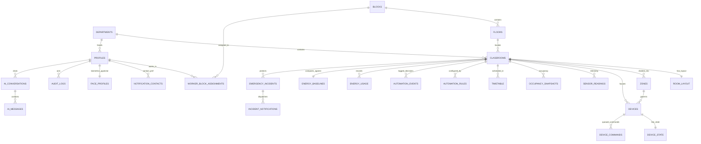

# Eco Class (Sustainable Class)

> **"Sustainable Class"** — Smart-Classroom Energy Conservation & Electrical Hazard Protection Platform for Colleges.

Eco Class monitors and automates college classroom lighting (per bench row) and ventilation using spatial occupancy, ambient daylight harvesting, and environmental comfort metrics. It eliminates phantom energy waste, enables workers and HODs to monitor and control equipment from mobile/web, and detects electrical faults (overcurrent, short circuit, arc fault) with automated power tripping and multi-channel staff notifications.

---

## 🏛️ System Architecture

```mermaid
flowchart TD
    subgraph Campus Hardware & Simulator ["Campus Hardware / Simulator Layer"]
        CAM["Vision Depth Camera"]
        LUX["Lux Daylight Sensor"]
        TH["Temp & Humidity Sensor"]
        PM["Smart Sub-Panel Power Meter"]
        LED["Bench Row LED Arrays (Zones 1-5)"]
        FAN["Smart Ceiling Fans"]
    end

    subgraph MQTT Broker ["MQTT Broker (Mosquitto / In-Memory Resilient)"]
        TOPIC_TELEM["Telemetry (Upstream)"]
        TOPIC_CMD["Commands (Downstream)"]
        TOPIC_ACK["Acknowledgements (Upstream)"]
    end

    subgraph Edge & Vision ["Vision Microservice (FastAPI + pgvector)"]
        FACE_API["Face Recognition & Embedding Engine"]
        PGVEC["512-dim Normalized Cosine Embeddings"]
        CONSENT["Privacy & Explicit Consent Enforcement"]
    end

    subgraph Backend Engine ["Eco Class Core Backend (Next.js App Router / Edge)"]
        AUTO_ENG["Deterministic Automation Engine"]
        LIGHT_ALG["Daylight Harvesting & Bench-Row Dimming"]
        FAN_ALG["Thermal Comfort Cooling & Grace Shutoff"]
        SAFETY["Anti-Flapping & Sensor-Loss Failsafe"]
        EMERGENCY["Hazard Detection & Power Trip Coordinator"]
        NOTIF["Multi-Channel Notification Dispatcher"]
        AI_SRV["Claude AI Assistant (Server-Side Tool Calling)"]
    end

    subgraph Supabase ["Supabase Data & Auth Plane"]
        AUTH["Supabase Auth (Google OAuth + Email/Password)"]
        RLS["Row Level Security (Admin / HOD / Worker / User)"]
        REALTIME["Realtime Publications (State / Incidents)"]
        PG_CRON["pg_cron (Hourly Energy View Refresh)"]
        AUDIT["Immutable Audit Logging"]
    end

    subgraph Frontend ["Modern Dark UI / Digital Twin Web & PWA"]
        UI_HERO["Modern Landing & Live Telemetry Hero"]
        UI_CAROUSEL["9-Module Twin Horizontal Carousel"]
        UI_HTU["Interactive How-To-Use Guide & FAQ"]
        UI_TWIN["3D Classroom Twin (CR-204)"]
        UI_MAP["Campus Topology Map"]
        UI_ENERGY["Energy Conservation Dashboard"]
        UI_HAZARD["Emergency Help Desk Banner"]
        UI_SIM["Simulator Benchmarking Lab & Debug Drawer"]
        UI_AI["AI Assistant Interactive Chat"]
    end

    CAM --> FACE_API
    FACE_API --> PGVEC
    LUX & TH & PM --> TOPIC_TELEM
    TOPIC_TELEM --> AUTO_ENG
    TOPIC_TELEM --> EMERGENCY

    AUTO_ENG --> LIGHT_ALG & FAN_ALG & SAFETY
    LIGHT_ALG --> TOPIC_CMD
    FAN_ALG --> TOPIC_CMD
    TOPIC_CMD --> LED & FAN
    LED & FAN --> TOPIC_ACK

    EMERGENCY -->|Automated Power Cut| TOPIC_CMD
    EMERGENCY --> NOTIF
    NOTIF -->|Push / Email / SMS| Staff["HODs & On-Duty Workers"]

    AUTO_ENG --> Supabase
    Backend Engine --> Supabase
    Backend Engine <--> Frontend
```

---

## 🗄️ Database Schema & Mermaid ER Diagram

All migrations are located in `supabase/migrations/`:
- `20261101000001_initial_schema.sql`: 23 core tables, indexes, constraints, soft deletes.
- `20261101000002_rls_policies.sql`: Row Level Security enabled on **every** table with strict role policies.
- `20261101000003_functions_triggers.sql`: Auth trigger, audit trigger, emergency power cut function, materialized views, Realtime publication.
- `seed.sql`: Realistic campus seed dataset (CSE & ECE departments, Blocks A & B, CR-204 layout, zones, timetable, baselines).



---

## 🔐 Auth & Role-Based Permissions (RLS Matrix)

| Role | Campus Map & 3D View | Energy Dashboard | Device Control (Manual Override) | Change Automation Rules | View / Acknowledge Emergencies | Promote Roles |
| :--- | :---: | :---: | :---: | :---: | :---: | :---: |
| **admin** | Full | Full | Universal | Full | Full | Yes |
| **hod** | Full | Full | Department Rooms | Department Rules | Department Incidents | No |
| **worker** | Full | Full | Assigned Blocks | View Only | Assigned Block Incidents | No |
| **user** (Student/Faculty) | View Only | View Only | ❌ Forbidden | ❌ Forbidden | ❌ Forbidden | No |

### Google OAuth ("Sign in with Gmail") Setup
1. **Google Cloud Console**:
   - Open [Google Cloud Console](https://console.cloud.google.com/) &gt; Create a project: `Eco-Class-Campus`.
   - Go to **APIs & Services** &gt; **OAuth Consent Screen**:
     - User Type: *External* (or *Internal* for Google Workspace domains).
     - App Name: `Eco Class`.
     - Scopes: `openid`, `email`, `profile`.
   - Go to **Credentials** &gt; **Create Credentials** &gt; **OAuth client ID**:
     - Application Type: *Web application*.
     - Authorized JavaScript Origins: `http://localhost:3000` (and production domain).
     - Authorized Redirect URIs: `https://<YOUR-SUPABASE-PROJECT>.supabase.co/auth/v1/callback`.
2. **Supabase Provider Config**:
   - In Supabase Dashboard &gt; **Authentication** &gt; **Providers** &gt; **Google**.
   - Enable Google, paste `Client ID` and `Client Secret`, and save.
3. **Allowlist & Default Role**:
   - Trigger `on_auth_user_created` automatically looks up `public.email_allowlist`.
   - Pre-registered staff get their designated role (`hod`, `worker`, `admin`).
   - Unregistered Gmail accounts default to `user` (read-only, no device control).

---

## ⚡ Core Automation Engine (Deterministic & Explainable)

The engine evaluates input signals in pure, testable TypeScript:
1. **Targeted Bench-Row Lighting**:
   - Ambient lux is deducted from target: `deficit = targetLux - ambientLux`.
   - Occupied bench rows receive artificial light proportional to deficit.
   - Unoccupied bench rows are dimmed to `10%` safety standby (or off).
   - **Key Test Case**: *One student on the last bench* -> Only Row 5 light is bright (`~80%`), while Rows 1–4 are dimmed to `10%`.
2. **Thermal Comfort & Smart Ventilation**:
   - Fans activate only when temperature &gt; `26.5°C` (or humidity &gt; `70%`) **AND** room is occupied.
   - Speed scales from 1 to 5 based on temperature delta and body count.
   - When occupants leave, fan remains on for a `5-minute grace period` before powering down.
3. **Timetable Lookahead**:
   - When a room is empty, engine inspects `timetable`. If a scheduled class starts within 10 minutes, shutdown is paused to keep the room prepared.
4. **Manual Override Immunity**:
   - Technicians/HODs can set device mode to `manual` or `forced_off` with an expiry timestamp. Engine respects overrides and never fights staff settings.
5. **Anti-Flapping & Anti-Flicker**:
   - `30 lux` hysteresis band prevents light flickering on cloud shifts.
   - `0.5°C` temperature hysteresis prevents fan bouncing.
6. **Sensor Loss Safety Failsafe**:
   - If telemetry times out (&gt; 60 seconds), engine triggers `FAILSAFE_TRIGGERED` mode: illumination defaults to a safe `70%` and fan to speed 2.

---

## 📡 MQTT Topic Design

| Direction | Topic Schema | Payload Example |
| :--- | :--- | :--- |
| **Telemetry (Up)** | `ecoclass/campus/{c}/block/{b}/room/{r}/device/{d}/telemetry` | `{"lux": 240, "temp": 25.5, "humidity": 52, "amps": 1.4, "volts": 230, "watts": 322}` |
| **Command (Down)** | `ecoclass/campus/{c}/block/{b}/room/{r}/device/{d}/command` | `{"power_on": true, "brightness_percent": 80, "mode": "auto", "idempotency_key": "k982"}` |
| **Ack (Up)** | `ecoclass/campus/{c}/block/{b}/room/{r}/device/{d}/ack` | `{"status": "acknowledged", "deviceId": "light-r5", "state": {"liveWatts": 48.0}}` |
| **LWT / Heartbeat** | `ecoclass/campus/{c}/device/{d}/status` | `{"status": "online", "last_heartbeat": "2026-11-01T10:00:00Z"}` |

---

## 🚨 Emergency Help Desk & Electrical Protection

- **Detection**:
  - Overcurrent: continuous load &gt; 25A on branch subpanel.
  - Short Circuit: current spike &gt; 50A with line voltage collapse &lt; 180V.
  - Thermal / Smoke: temperature sensor &gt; 60°C.
  - Manual Staff Trigger: one-click breaker trip from web UI or AI assistant.
- **Automated Protective Flow**:
  1. Automated circuit power cut is executed immediately (`mode = 'forced_off'`).
  2. Creates `emergency_incidents` record with severity classification.
  3. Dispatches multi-channel alerts (Web Push + Email + SMS) to HOD and assigned Workers only (students excluded).
  4. Real-time emergency banner activates on staff dashboards.
  5. Staff acknowledge and resolve incident with timestamped audit trail.

---

## 🤖 AI Assistant (Claude Tool Calling)

Available server-side tools:
- `get_classroom_status(classroom_id)`
- `get_block_summary(block_id)`
- `get_occupancy_by_row(classroom_id)`
- `get_energy_stats(period, classroom_id)`
- `explain_automation_decision(classroom_id, limit)`
- `list_empty_rooms(block_id)`
- `recommend_brightness(classroom_id, row_index)`
- `switch_off_devices(classroom_id, device_ids, reason)` *(Staff only)*
- `raise_incident(classroom_id, incident_type, severity, description)` *(Staff only)*

### Prompt Injection Defenses
- All database records and user queries are treated strictly as **DATA**, wrapped inside structured delimiters.
- Permissions are enforced **in code** before tool execution, never relying on prompt instructions alone.
- Any attempt by a `user` role to trigger `switch_off_devices` returns HTTP 403 / Forbidden error and logs an audit attempt.

---

## 🚀 Quick Start & Local Development

### 1. Prerequisites
- Node.js &gt;= 18 (Node 20+ recommended)
- Python 3.10+ (for FastAPI Face Service)
- Docker &amp; Docker Compose (optional, for complete container stack)

### 2. Install & Configure
```bash
# Clone and enter repo
cd Eco_CLass26

# Install Node dependencies
npm install

# Copy environment variables
cp .env.example .env.local
```

### 3. Run Test Suite
```bash
# Runs all 25 unit and integration tests across 6 test suites
# (UI Components & Campus Config, Automation Engine, RLS Roles, Emergency Hazard, Simulator, AI Tools)
npm test

# Check TypeScript compiler
npm run typecheck

# Production build verification
npm run build
```

### 4. Start Next.js Development Server
```bash
npm run dev
# Open http://localhost:3000 in your browser
```

---

## 🎨 UI & Operational Routing Architecture

| Route | Module / Feature | Description |
|---|---|---|
| `/` | **Landing Page** | Centered high-impact Hero, 4 live telemetry counters, 9-module horizontal scroll carousel, 5-step operational stepper, Net-Zero innovation cards |
| `/how-to-use` | **Operational Guide** | Step-by-step role guides (Admin, HOD, Worker, Student), searchable FAQ accordion, keyboard shortcut index |
| `/dashboard` (or `/energy`) | **Command Center** | Real-time campus load (kW), carbon avoidance (kg CO₂e), historical trends, and CSV report export |
| `/campus-map` (or `/map`) | **Campus Topology Map** | Digital twin of campus blocks (Turing, Tesla, Raman, etc.) with department heatmaps |
| `/classroom-3d` (or `/classroom/c1...`) | **3D Classroom Twin** | Row-by-row bench spatial lighting & thermal fan state with real-time seat placement simulator |
| `/vision-lab` | **Vision Lab** | Edge AI camera pipeline, 512-dim face embeddings, privacy consent toggles |
| `/automation` | **Automation Rules** | Configurable lux target formulas, temperature thresholds, occupancy timers, failsafe rules |
| `/simulator` | **What-If Simulator** | 5 real-time electrical & occupancy scenarios (Short Circuit, Class in Session, Evening Study, Empty Room, Heatwave) |
| `/helpdesk` (or `/incidents`) | **Emergency Help Desk** | Instant hazard notifications, automated circuit trips, triage workflow (Acknowledge, Dispatch, Resolve) |
| `/assistant` | **Eco AI Assistant** | Claude 3.5 Sonnet server-side tool calling with explanation of automation decisions |
| `/admin` | **User & Roles Console** | Manage role promotions (Admin, HOD, Worker, User), invite allowlists, audit logs |

> **Pro Tip:** Press <kbd>Ctrl</kbd> + <kbd>Shift</kbd> + <kbd>D</kbd> anywhere in the app to open the **Admin Simulator & Debug Drawer** to trigger electrical faults or test edge scenarios instantaneously.

### 5. Start Python Face Recognition Service (Optional)
```bash
cd face-service
pip install -r requirements.txt
uvicorn main:app --host 0.0.0.0 --port 8000 --reload
```

### 6. Full Docker Compose Deployment
```bash
docker compose up -d
```

---

## 📋 Presentation & Demo Script

Follow this step-by-step walkthrough to present the project:

1. **Landing Page (`/`)**:
   - Point out "Eco Class | Sustainable Class" branding and summary cards.
2. **Campus Map (`/map`)**:
   - Show spatial monitoring of Turing Block (BLOCK-A) and Tesla Block (BLOCK-B).
3. **3D Classroom Digital Twin (`/classroom/c1000000-0000-0000-0000-000000000204`)**:
   - Explain the 5 bench rows and 30 student seats.
   - Use the **Interactive Seat Placement Tool** on the right: Place 1 student in Row 5 (Last Bench) and click "Update Occupancy & Run Engine".
   - Notice Row 5 immediately turns **⚡ Active (80% brightness)** while Rows 1–4 remain in **🌙 Safety Dim (10%)**!
   - Review the live **Power Flow Tree** showing watts per zone.
4. **Hardware Simulator Lab (`/simulator`)**:
   - Select the preset scenario: **"Short Circuit & Arc Fault"** and apply it.
   - Observe the power meter spike and breaker trip!
5. **Emergency Help Desk (`/incidents`)**:
   - Show the red real-time emergency banner with the short-circuit hazard.
   - Point out **⚡ AUTOMATIC POWER CUT TRIPPED**.
   - Click "Acknowledge", enter inspection notes, and click "Mark Resolved".
6. **AI Assistant (`/assistant`)**:
   - Click the prompt chip: *"Why is the front row dim?"*
   - See Claude execute `explain_automation_decision` and cite zero occupants in Row 1.
   - Switch role to *User / Student* and ask to turn off devices: demonstrate the permission barrier in action!
7. **Energy Dashboard (`/energy`)**:
   - Review actual vs baseline consumption (saving ~48% energy).
   - Click "Export CSV Report" to download the report.

---

## 📝 Configuration Checklist

- [ ] **Google Cloud Console**: Create OAuth 2.0 Web Client and add `https://<YOUR-PROJECT>.supabase.co/auth/v1/callback`.
- [ ] **Supabase Authentication**: Enable Google Provider and paste Client ID / Secret.
- [ ] **Supabase Database**: Apply migrations `20261101000001_initial_schema.sql`, `20261101000002_rls_policies.sql`, `20261101000003_functions_triggers.sql`, and `seed.sql`.
- [ ] **Anthropic Claude API**: Supply `ANTHROPIC_API_KEY` in `.env.local` for production Claude 3.5 Sonnet tool calling (built-in intelligent mock operates in dev/test).
- [ ] **Notification Providers**: Set `EMAIL_PROVIDER=resend` (or `smtp`) and `SMS_PROVIDER=twilio` if live SMS/email alerts are desired.
- [ ] **MQTT Broker**: Connect to external Mosquitto/HiveMQ broker via `MQTT_BROKER_URL`, or leave as `internal` to use the zero-dependency built-in broker.
